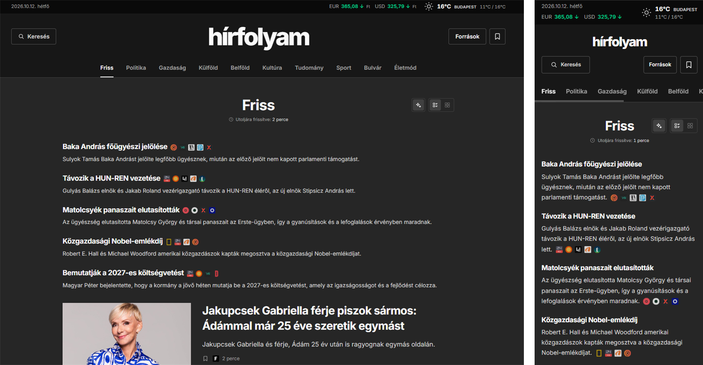

# hírfolyam

hírfolyam is a Hungarian news aggregator that currently collects the RSS feeds of 60 news sources in one place, organized into categories, with AI-based summaries.

## Features

- **Latest news**: the newest articles from every source in a single feed with infinite scrolling.
- **Categories**: news filterable by politics, economy, world, domestic, culture, science, sport, celebrity and lifestyle.
- **Hot topics**: stories covered by multiple sources are briefly summarized by AI, with the sources indicated.
- **Daily recaps**: besides the last hour hot topics, a recap of today and yesterday is available.
- **Search**: free-text search across articles and categories.
- **Sources**: choose which news sources articles are shown.
- **Bookmark articles**: bookmark articles to read later.
- **List and grid views**: switchable layout for articles.
- **RSS feed**: public feed available at /api/rss containing the latest articles from all the sources.

## License

[MIT](LICENSE)
